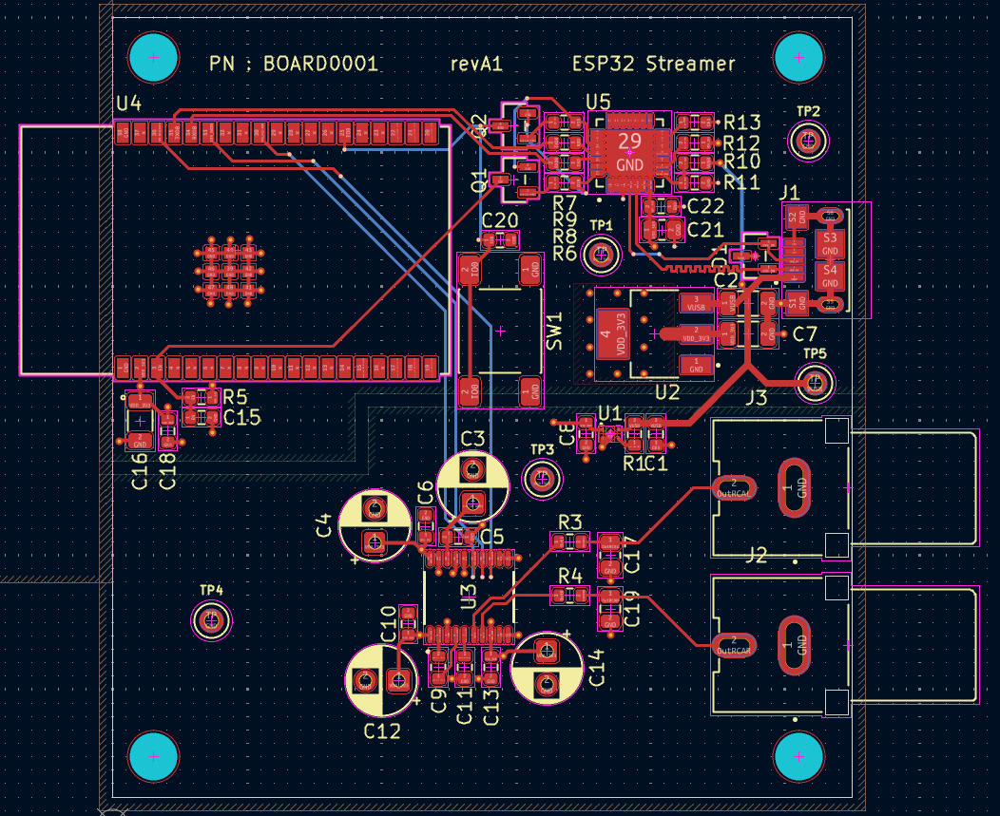
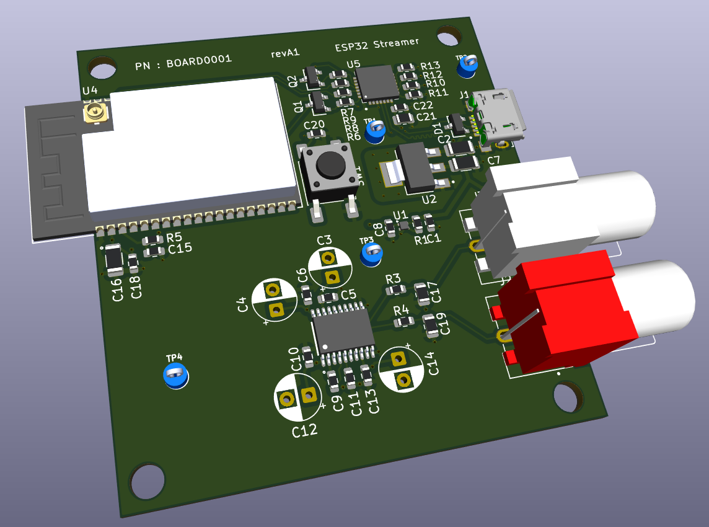

# Console

Pour pouvoir utiliser une vieille chaîne HI-FI avec Spotify ou en Bluetooth, j'ai imaginé une carte équipée d'un ESP32 et d'un DAC, permettant de récupérer un flux Bluetooth ou **Spotify Connect**, de le traiter avec Squeezelite et de le restituer sur une sortie RCA, afin de le connecter à une entrée AUX de la chaîne HI-FI.

*Projet encore en cours de réalisation.*

*Schéma :*

*Routage :*

*Vue 3D :*

